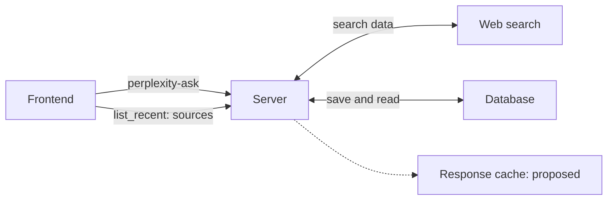
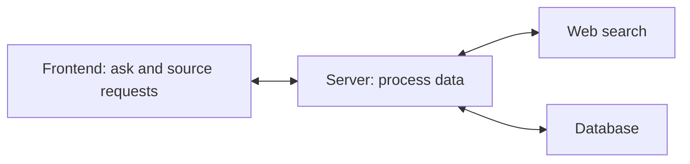
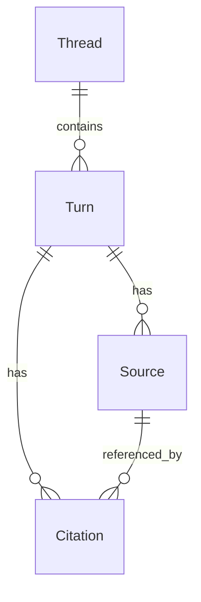
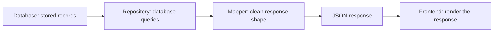

# My Perplexity design notes

[Docs](../../README.md) · [Design history](../../DESIGN_HISTORY.md) · [Source record](manifest.json)

Rewritten on 12 November 2026 from my eight notebook pages, IMG_1087–IMG_1094.
The first page is dated `03/06/26`. Wording and diagrams are cleaned up for reading;
this is an edited reconstruction, not a verbatim transcription or a new account
of today's implementation. Page IDs retain the connection to the reviewed originals.

Checklist marks and crossed-out writing do not establish that a feature shipped.
Unclear fields remain marked with `?`. Later decisions and current implementation
belong in [Design history](../../DESIGN_HISTORY.md), [Architecture](../../ARCHITECTURE.md),
and [API](../../API.md).

Each section links to a clean regenerated note image. These are concise visual
summaries, not original photographs. The text retains details and uncertainties
that are intentionally omitted from the minimal images.

## IMG_1087 — My design process

[View clean note page](visuals/01-design-approach.png).

1. Understand the product. Review/audit the repository and write down key information.
2. Define the main user.
3. Identify the core loop.
4. Separate core, supporting, and advanced features.
5. Write functional and nonfunctional requirements.
6. Break the system into components.
7. Trace the main request and data flow.
8. Choose an MVP vertical slice.
9. Design APIs after the design is clear.
10. Build small, with clean boundaries.
11. Evolve version by version.

Items 4 and 5 were crossed out in the original. I did not record why, so that
mark is retained as an uncertainty rather than a decision to reject the work.
The minimal visual combines component modeling and flow tracing into one item;
the full eleven-item sequence is retained above.

## IMG_1088 — Product, users, and design framework

[View clean note page](visuals/02-product-and-users.png).

My system-design framework covers product understanding, requirements, constraints,
data and flow modeling, component design, trade-offs, and implementation planning.
The original contains checks/cross-outs; the implementation-planning box is empty.

**Product:** a conversational answer engine that searches the web in real time
and provides direct, synthesized answers with inline citations and sources.

**Target users:** researchers, students, and professionals who need accurate,
verifiable, source-cited information. The intended value is an answer they can
inspect, rather than only a ranked list of links.

These are the intended users and value proposition, not evidence of a completed
user study or measured answer accuracy.
The visual also includes reading and follow-up priorities from IMG_1089 and
cites both source pages.

## IMG_1089 — My product observations

[View clean note page](visuals/03-product-observations.png).

I compared Perplexity, ChatGPT, and Claude under a real-time data and synthesis test.
These are the observations I wrote down at the time:

- **Perplexity:** highly synthesized answers with a clear narrative, citations,
  and source summaries. The interface was clean and readable, with a sources
  tab and follow-up questions.
- **ChatGPT:** synthesized information and citations appeared similar, but the
  narrative and reading experience felt less clear. I did not observe follow-ups
  or a clear sources tab in that interaction.
- **Claude:** a clear, synthesized answer with fewer points and fuller sentences
  across a few sections. Readability felt slightly clearer than ChatGPT, but I
  did not observe a source-link tab in that interaction.

Design emphasis: synthesized answers, inspectable citations/sources, follow-ups,
and a clean reading experience.

I did not record the exact prompt, model versions, settings, raw answers, or
scores on this page. These observations are historical and qualitative; they
cannot establish a current product ranking or reproducible benchmark.

## IMG_1090 — My initial API sketch

[View clean note page](visuals/04-early-api-sketch.png).

The original names were sketches, not today's route contract:

- POST `api/perplexity-ask`: accept a question/query and additional parameters.
  The payload sketch uses a `query_str`-style field and a parameters object.
- GET `api/list_recent`: return an array of objects, with a best-effort field
  reading of `{context_id?, link?, status, title}`. The question marks indicate
  uncertain handwriting, not optional fields in a defined schema.

I labeled ask as the query/follow-up request and `list_recent` as the sources
request. My note says to fetch sources after ask for a quicker response.
This page does not establish that `list_recent` meant the current thread-history API.

## IMG_1091 — My component sketch

[View clean note page](visuals/05-component-sketch.png).

I sketched a login/register bar, a frontend, a server, web search, a database,
and response caching. A credits label also appears on the server sketch, without
accounting behavior specified here. The server would process search data, format
sources, and check whether a response could be reused.

This is a simplified redraw of the proposed relationships:

Login/register and caching were design ideas. Their presence in the sketch is
not evidence that either was implemented. Later decisions are recorded separately.

## IMG_1092 — My MVP and future priorities

[View clean note page](visuals/06-mvp-and-next-steps.png).

Start with the smallest complete request/response loop:

The next-feature list contains:

- Cache responses for similar queries.
- Credit-based usage.
- Deep Research — marked **most important**.

The original credit-usage box has a mark whose meaning is ambiguous. The later
author clarification says it was intended and never built. The later roadmap
keeps Deep Research as the goal and defers credit/billing work to productization.

## IMG_1093 — My server setup and domain model

[View clean note page](visuals/07-domain-model.png).

The notebook's original “Phase 1 Server” means the early server-build stage,
not today's Foundation Track Phase 1.

Server setup: initialize NestJS, remove unnecessary setup files, configure Prisma,
and define the schema.

- **Thread:** a whole research session containing many turns.
- **Turn:** one question/answer exchange, belonging to one thread and containing
  its sources and citations.
- **Source:** web evidence used for an answer, belonging to one turn. Multiple
  citations may reference one source.
- **Citation:** a marker in an answer, belonging to one turn and pointing to one source.

These are the domain relationships I wanted to preserve. A saved citation maps
an answer reference to a source; that relationship alone does not prove a claim
is factually supported.

## IMG_1094 — My API layers and implementation-order lesson

[View clean note page](visuals/08-api-boundaries.png).

The later sketch lists three API responsibilities:

1. POST ask: send a request through the server/web-search flow and return an answer.
2. GET recent sources: retrieve source information.
3. GET threads: retrieve thread information.

For reading stored data, I separated database access, mapping, response formatting,
and frontend rendering:

My reflection: I built APIs in the order sources → threads → ask, and recorded
that as a mistake. Ask should come first, then the supporting APIs.

The lesson is to prove a small end-to-end user journey before expanding its
supporting interface. This read-layer diagram is not the full execution order
of the current ask pipeline; use the architecture document for that sequence.
